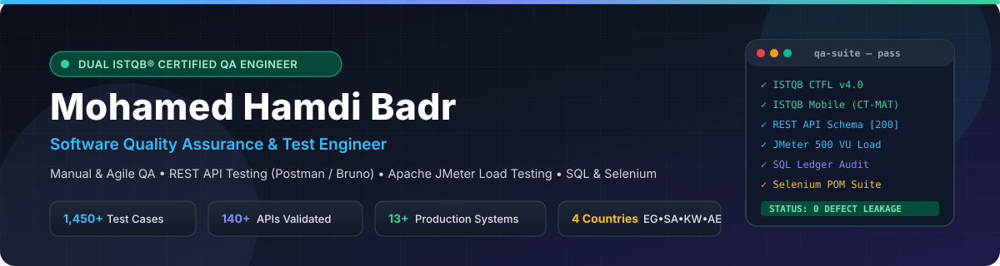

<div align="center">



<br/>

[](https://www.linkedin.com/in/mohamed-hamdi-badr/)
[](mailto:mohamedhamdibadr9@gmail.com)
[](https://wa.me/201050156646)
[](https://github.com/mohamed-hamdi-badr/qa-engineering-portfolio)

</div>

---

## 🎯 Executive Summary

**Dual ISTQB® Certified Software QA Engineer (`CTFL v4.0` & `CT-MAT`)** with **2+ years of hands-on experience** ensuring production reliability across **13+ enterprise Web, Mobile (iOS/Android), ERP, FinTech, LegalTech, E-Commerce, and IoT systems** in **Egypt, Saudi Arabia, Kuwait, and the UAE**.

```yaml
name: Mohamed Hamdi Badr
role: Software QA Engineer (Manual, API, Performance & Automation)
location: Cairo, Egypt
certifications:
  - ISTQB® Certified Tester Foundation Level (CTFL v4.0)      # ID: 250625056
  - ISTQB® Certified Tester Mobile App Testing (CT-MAT)       # ID: 251008214
  - API Test Automation with Postman (TAU)                    # ID: 162fba3a
  - Exploring Service APIs through Test Automation (TAU)      # ID: b7c50986
core_impact:
  test_cases_authored: "1,450+ Functional, Integration, Regression & E2E Suites"
  apis_validated: "140+ RESTful Endpoints (Postman & Bruno Collections)"
  performance_testing: "500+ Concurrent Virtual Users (Apache JMeter) — 30% Faster APIs"
  defect_reduction: "35% Decrease in Production Defect Leakage across Bi-Weekly Sprints"
```

---

## 🛠️ QA Tech Stack & Testing Arsenal

<div align="center">

| **API & Performance Testing** | **Automation & Programming** | **Database & Backend Audit** | **Test Management & Agile** |
| :---: | :---: | :---: | :---: |
|   <br/>   |   <br/>   |   <br/>   |   <br/>   |

</div>

---

## 🌐 Live Production Systems Tested (Selected Highlights)

Here is a snapshot of real-world platforms I have tested and verified across the MENA region:

| Project / Platform | Domain & Market | Testing Scope & Key QA Deliverables | Live Link |
| :--- | :--- | :--- | :---: |
| **Enterprise Accounting ERP** | 🏦 FinTech / ERP *(Egypt)* | Validated general ledger accounting, RBAC permissions, and cross-module data sync across **12+ administrative modules** via SQL & API tests. | [🔗 Live Platform](https://erpaccounts.gate-gold.com/admin/login) |
| **Electron Borsa** | 📈 B2B Trading & ERP *(Egypt)* | Audited purchase/sale transactions, digital wallet calculations, stock transfers, and real-time notifications; caught **45+ data-mismatch bugs**. | [🔗 Live Platform](https://borsa.gate-gold.com/admin/dashboard) |
| **MOI Club App (Kuwait)** | 🏛️ GovTech Mobile *(Kuwait)* | Executed **Apache JMeter load tests (500+ concurrent users)** + Android/iOS functional testing; uncovered 4 bottlenecks & cut response time by **30%**. | [📱 Google Play](https://play.google.com/store/apps/details?id=com.moimobileapplication&hl=en) |
| **Safe Road IoT Platform** | 🛰️ IoT & Fleet Safety *(KSA)* | Tested real-time hardware telemetry ingestion, JSON payload schema validation, and REST API sync between road sensors and cloud dashboards. | [🔗 Web](https://www.saferoad.com/) • [📱 App](https://play.google.com/store/apps/details?id=com.syrovatko.saferoad) |
| **Lawhub24 & Taqneen** | ⚖️ LegalTech SaaS *(KSA)* | Verified multi-tenant legal case workflows, dual-role (Client/Lawyer) journeys, consultation booking, payment gateways, and live chat. | [🔗 Lawhub24](https://lawhub24.com/) • [🔗 Taqneen](https://eg.app.tqneen.com/) |
| **KNAcademy** | 🎓 Medical EdTech *(MENA)* | Tested course enrollments, payment gateways, **DRM offline video playback**, and student progress tracking across Web, Android, and iOS. | [🔗 Live Platform](https://knacademy.net/) |
| **Sooq.in Marketplace** | 🛒 Multi-Vendor E-Commerce | Validated vendor onboarding, dynamic search/filtering algorithms, cart persistence, and end-to-end checkout pipelines. | [🔗 Live Platform](https://sooq.in/) |
| **Outlet Plus & Sree3 App** | 💊 E-Pharmacy & Delivery *(KSA)* | Verified live GPS order tracking, dynamic menus, coupon/tax rules, push notifications, and Arabic/English RTL/LTR localization. | [🔗 Outlet Plus](https://www.outletplus.sa/) • [📱 Sree3](https://play.google.com/store/apps/details?id=com.cems_it.sree3_client) |
| **Pinnacle Real Estate** | 🏙️ PropTech *(Dubai, UAE)* | Audited property search engines, lead-capture pipelines, and **4-language localization (AR, EN, RU, ES)**, resolving 20+ RTL/LTR layout defects. | [🔗 Live Platform](https://pinnacleproperties.ae/) |

---

## 📂 Featured QA Engineering Portfolio

> 💡 Looking for code samples, test cases, bug reports, API collections, and JMeter plans?
> Explore my public **[`qa-engineering-portfolio`](https://github.com/mohamed-hamdi-badr/qa-engineering-portfolio)** repository featuring:
> - 📋 **Enterprise Master Test Suites** (Functional, Regression, Financial Ledger, Security & Localization)
> - 🐞 **Standardized Defect Reports** (With Root Cause Analysis, HTTP Payloads & SQL Evidence)
> - 🔌 **Postman / REST API Automation Suites** & JSON Schema Assertions
> - ⚡ **Apache JMeter Performance Test Architecture** & SQL Data Integrity Audit Queries

---

## 🏅 Verified Certifications

- 🎖️ **ISTQB® Certified Tester – Foundation Level (CTFL v4.0)** — *International Software Testing Qualifications Board (ID: `250625056`)*
- 🎖️ **ISTQB® Certified Tester – Mobile Application Testing (CT-MAT)** — *International Software Testing Qualifications Board (ID: `251008214`)*
- 🎖️ **API Test Automation with Postman** — *Test Automation University (ID: `162fba3a`)*
- 🎖️ **Exploring Service APIs through Test Automation** — *Test Automation University (ID: `b7c50986`)*

---

<div align="center">

### 🤝 Let's Connect & Build High-Quality Software
[**LinkedIn**](https://www.linkedin.com/in/mohamed-hamdi-badr/) • [**Email**](mailto:mohamedhamdibadr9@gmail.com) • [**WhatsApp (+20 105 015 6646)**](https://wa.me/201050156646)

</div>
